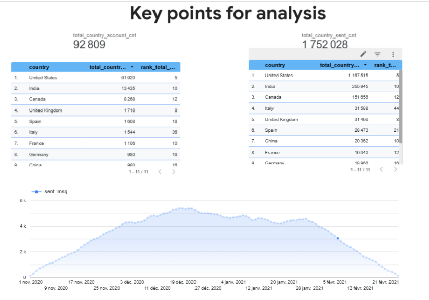

# Email & Account Metrics by Country (SQL / BigQuery)

## Goal
Analyze how user accounts and email activity (sent, opened, clicked-through messages) are distributed across countries, and identify the top 10 countries by number of accounts and by number of emails sent.

## Data
Google BigQuery, dataset `data-analytics-mate.DA`:
`account`, `account_session`, `session`, `session_params`, `email_sent`, `email_open`, `email_visit`.

## What the query does
- Joins sessions, countries and accounts into one base CTE (`session_data`).
- Builds account metrics and email metrics separately (`account_metrics`, `email_metrics`), then merges them with `UNION ALL`.
- Aggregates by date, country, send interval, verification status and unsubscribe status.
- Calculates country totals with window functions (`SUM() OVER (PARTITION BY country)`).
- Ranks countries with `DENSE_RANK()` and keeps those in the top 10 by accounts or by sent emails.

**SQL techniques:** CTEs, multiple JOINs (incl. LEFT JOIN), UNION ALL, GROUP BY, window functions, DENSE_RANK.

## Result
The output was visualized in a dashboard (screenshot below).

- Total accounts: 92,809
- Total emails sent: 1,752,028
- The United States leads by both accounts and sent emails, followed by India and Canada.
- Email volume grows from November 2020, peaks around December 2020, and declines by February 2021.

  
